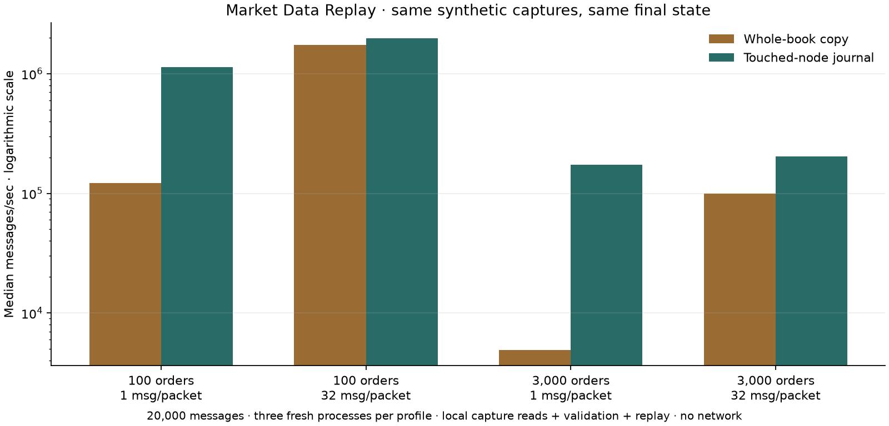

# Market Data Replay

<!-- project-navigation:start -->
[Architecture](docs/ARCHITECTURE.md) · [Design choices](docs/DECISIONS.md) · [Portfolio](docs/PORTFOLIO.md) · [Demo and deployment](docs/DEPLOYMENT.md)
<!-- project-navigation:end -->

A C++20 replay engine for a documented subset of Nasdaq ITCH 5.0 messages inside MoldUDP64 datagrams. It reconstructs visible orders, detects missing sequences, handles overlapping retransmissions, and saves validated restart checkpoints.

This is an original implementation with an independent Python reference. Fixtures are owned synthetic data, not licensed Nasdaq captures. The supported subset is intentionally narrow; an arbitrary full production feed contains unsupported message types and will be rejected.

## Run

Requires a C++20 compiler, Make, and Python 3.10+; no third-party runtime dependencies.

```sh
make
python3 scripts/fixtures.py --output runtime/demo.mdr
build/replay --input runtime/demo.mdr --save runtime/state.chk
make test
make sanitize
```

Replaying the same capture against its completed checkpoint ignores the already-applied message ranges:

```sh
build/replay --input runtime/demo.mdr --load runtime/state.chk --summary
```

`--summary` omits the order list. The state checksum still covers every active order and sequence metadata. Checkpoints include a non-cryptographic FNV-1a checksum and strict structural/bounds validation; they are not authenticated exchange snapshots.

## Integrity contract

- Supported messages: **A/F** add, **E/C** execute, **X** cancel, **D** delete, **U** replace, **S** system event.
- Every binary read is bounded; exact message sizes, quantity reductions, active references, symbols/locates, timestamp bounds and integer prices are validated.
- A session starts with an empty book at sequence 1, or from a loaded checkpoint. Missing sequences and session changes are rejected; the trusted state does not advance.
- Whole retransmissions are ignored after validating packet framing. Overlaps skip the already-applied prefix and apply only a contiguous new suffix. Old payloads are not retained or checked for conflicting content; this is sequence-based deduplication, not authenticated source validation.
- Each packet is applied to a staged book and committed only after all new messages validate. A valid event followed by an invalid event cannot partially mutate the trusted state.
- Heartbeats and end-of-session control packets must match the next expected sequence exactly. Only MoldUDP64 end-of-session closes replay; S events are validated metadata and do not reset state.
- Limits: 65,507-byte datagrams, 64 MB capture, 100,000 packets, 1,000,000 newly applied messages, and 10,000 active orders.

The project-specific capture format is a four-byte big-endian datagram length followed by each complete MoldUDP64 payload. This is **not PCAP**. Never remove unsupported messages from an existing feed and pretend the remaining sequence numbers are contiguous.

## Engineering tradeoffs

Packet atomicity journals only touched order IDs. Original map nodes remain owned by the journal until commit, allowing allocation-free rollback after deletion or replacement, including an allocation failure. An optional `REPLAY_COPY_ATOMICITY` compile flag retains the simple whole-book-copy baseline. Adds still scan active orders to check locate consistency, so depth remains a cost. [Measured tradeoffs](docs/BENCHMARKS.md) are local synthetic results, not low-latency production claims. Active references are checked for duplicates; previously deleted reference IDs are not retained indefinitely. No matching, trade tape, hidden liquidity, auction logic, queue positions, network transport, retransmission requester or live trading is implemented.

Prices remain integer units of 1/10,000 and visible quantities remain integer shares. Crossed books are not rejected because a reconstruction tool must not invent matching behavior during auctions. Attributed replacements preserve stock, side and MPID. Priced/non-printable executions reduce displayed quantity regardless of their tape-printing flag.

## Validation and references

Tests cover all supported message types, five seeded streams against an independent Python book, truncation at every byte of an add packet, malformed lengths, gap/session/end handling, overlap deduplication, checkpoint restart/tampering, packet rollback/recovery, injected allocation failures across delete/replace/reference reuse, active-order bounds and malformed-packet smoke cases. Sanitizers run the same suite. These are bounded regression checks, not exhaustive fuzzing or exchange certification.

Primary protocol references: [Nasdaq TotalView-ITCH 5.0](https://www.nasdaqtrader.com/content/technicalsupport/specifications/dataproducts/NQTVITCHSpecification_5.0.pdf) and [MoldUDP64](https://www.nasdaqtrader.com/content/technicalsupport/specifications/dataproducts/moldudp64.pdf). Nasdaq owns its protocol documentation and licensed market data. No upstream implementation was copied. Original code is MIT licensed.

See [scope](PROJECT_SCOPE.md), [transaction design](docs/TRANSACTIONS.md), [repeatable benchmarks](docs/BENCHMARKS.md), and [portfolio notes](docs/PORTFOLIO.md).


