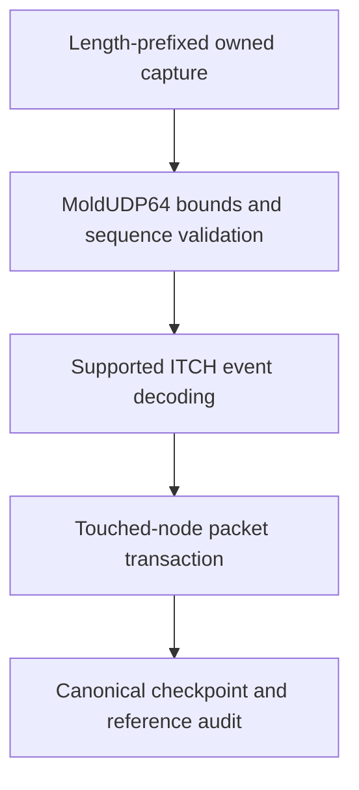

# Architecture

Bounded ITCH-subset decoding and MoldUDP64 replay with sequence checks, overlapping retransmissions, and atomic packet recovery.

## Data flow

## Source map

- [src/replay.hpp](../src/replay.hpp)
- [src/main.cpp](../src/main.cpp)
- [tests/reference.py](../tests/reference.py)
- [tests/allocation.cpp](../tests/allocation.cpp)
- [scripts/benchmark.py](../scripts/benchmark.py)

## Evidence and boundaries

Independent book reference, sanitizer checks, and allocation-failure rollback evidence. No live feed, PCAP parser or retransmission requester; checksum is not authentication.

See [setup and recorded results](../README.md), [design choices](DECISIONS.md), and [portfolio notes](PORTFOLIO.md).
