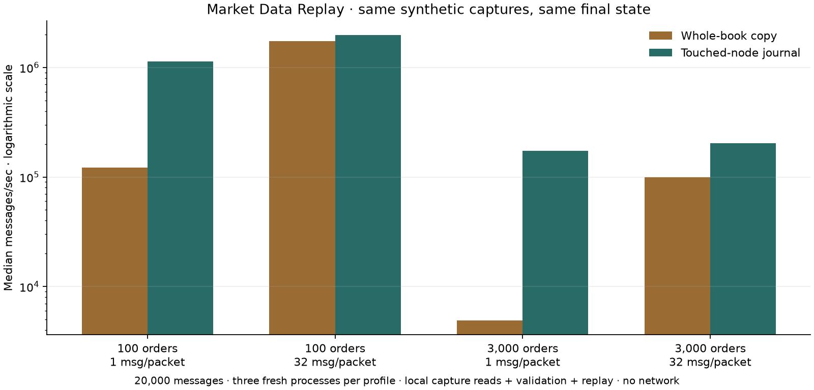

# Market Data Replay

**Repository:** https://github.com/victorhuii/market-data-replay  
**Role:** Original C++20 binary decoder, deterministic visible-order reconstruction, checkpoint recovery and controlled performance optimization.  
**Stack:** C++20 standard library, Python reference/test tools, Make, GitHub Actions. No paid data or hardware.

## Website description

A bounded C++ market-data replay engine that reconstructs visible orders from a documented Nasdaq ITCH subset carried inside MoldUDP64 datagrams. It rejects missing sequences and invalid events, deduplicates overlapping retransmissions, and preserves trusted state across packet failures. A measured transaction-journal optimization improves deep-book replay without changing capture identities or final state.



[SVG for your website](assets/replay-benchmark.svg). The chart shows measurements on owned synthetic fixtures, not a real exchange feed.

## Engineering decisions

- Decode big-endian binary fields with explicit size, integer, timestamp and semantic bounds; preserve integer share/price units.
- Apply only contiguous new message suffixes, reject session changes and forward gaps, and make end-of-session replay idempotent.
- Preserve original order nodes in a per-packet journal. Invalid messages and allocation failures restore pre-packet orders and metadata; replacements preserve stock, side and MPID.
- Save canonical checkpoints with structural validation and a non-cryptographic checksum. These are local restart aids, not authenticated exchange snapshots or power-loss durability claims.
- Cross-check five seeded streams against an independent Python implementation and run eleven regression groups under address/undefined-behavior sanitizers. A fault-injection harness verified 27 allocation-failure rollback points on the measured build.

## Measured performance

The 3,000-order, one-message-per-packet workload improved from 4,920 to 173,313 messages/sec (35.23× median across three fresh processes per version). The shallow 32-message packet workload reached approximately 1.97 million messages/sec. All tests use 20,000 generated messages and local file input; fixture generation and output are excluded. Capture hashes and final state checksums match across versions.

Sequential measurements can be affected by cache state and machine load. These are neither live-feed latency nor a production capacity claim. Active locate-consistency scans remain a depth-dependent cost. Read [raw measurements and tradeoffs](BENCHMARKS.md).

## Resume bullets

- Built a C++20 ITCH-subset replay engine with bounded binary parsing, MoldUDP64 gap detection, retransmission deduplication, and validated restart checkpoints.
- Replaced whole-book packet copies with a touched-node rollback journal, preserving state across 27 injected allocation-failure points and improving a fixed deep-book workload 35.2× against the measured baseline.

## Demo

```sh
make
python3 scripts/fixtures.py --output runtime/demo.mdr
build/replay --input runtime/demo.mdr --save runtime/state.chk --summary
build/replay --input runtime/demo.mdr --load runtime/state.chk --summary
make test
make sanitize
```

The second replay applies zero new messages and preserves the final state identity. All fixture bytes are generated locally; no exchange entitlement or hardware is required.

## Attribution and limits

Original MIT-licensed code. Wire layout/semantics follow [Nasdaq ITCH 5.0](https://www.nasdaqtrader.com/content/technicalsupport/specifications/dataproducts/NQTVITCHSpecification_5.0.pdf) and [MoldUDP64](https://www.nasdaqtrader.com/content/technicalsupport/specifications/dataproducts/moldudp64.pdf); Nasdaq's protocol documentation and market data remain theirs. No other repository's implementation was copied.

Only A/F/E/C/X/D/U/S messages are supported. Arbitrary production feeds contain other message types and fail closed. There is no multicast transport, PCAP support, recovery requester, trade tape, hidden-liquidity reconstruction, matching, queue-position model or live trading. See [transaction design](TRANSACTIONS.md) and [scope](../PROJECT_SCOPE.md).
